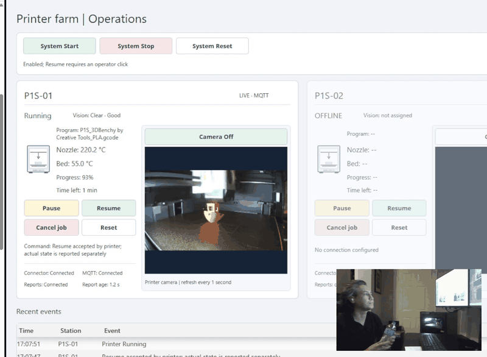
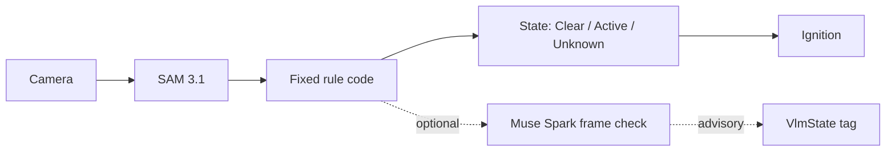
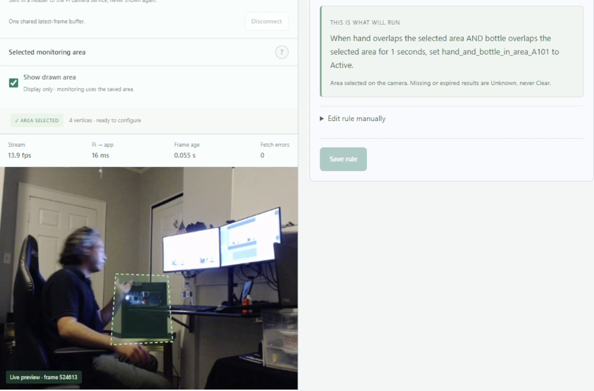
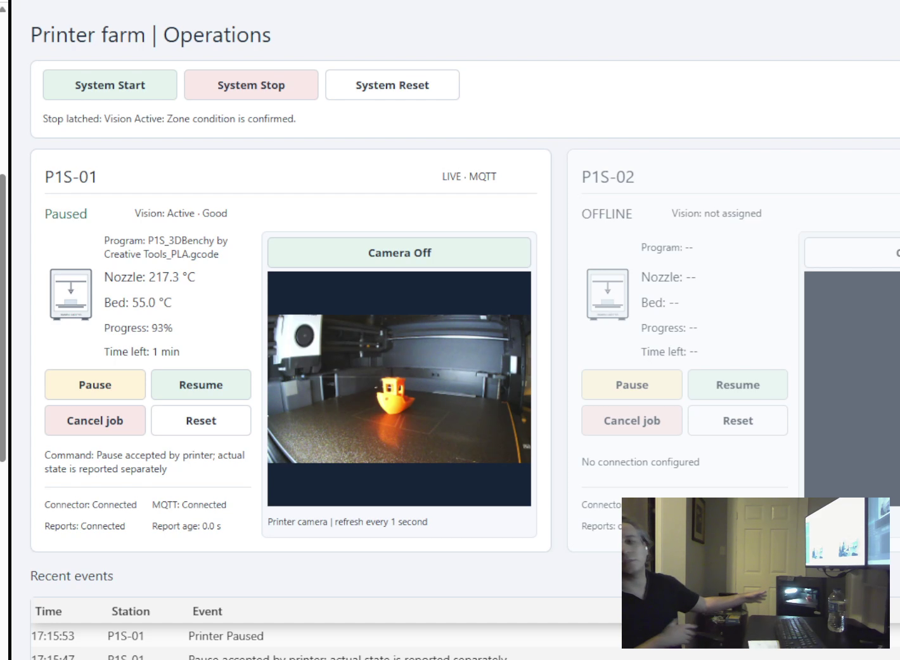

# vLock-AI Vision

Set up camera vision with a prompt. SCADA gets one simple state per zone: Clear, Active or Unknown.

No model training and no vendor integrator: type what to watch, draw the area, and bind the tags over OPC UA, MQTT or REST. The main example is a restart permissive, where SCADA accepts a reset only while the zone reads `Clear`.

## Demo



[Watch the full demo video](https://youtu.be/5BJcpr42i7c)

A person with a water bottle in front of a 3D printer, shown in an Ignition Perspective view. The bottle stands in for any object or person that should not be in a hazard zone.

- **Rule, zone `A-101`:** `hand overlaps the area AND bottle overlaps the area for 1 s`.
- **Stop:** a hand and a bottle are both in the drawn area on two fresh checks. `State` goes `Active`, Ignition latches a stop and sends the printer one Pause.
- **Clear:** the hand and the bottle are not both in the area. `State` reads `Clear` and the print continues. After a stop, `Clear` alone restarts nothing.
- **Reset:** System Reset is accepted only while `State` is `Clear`. It is refused while the zone reads `Active`, so it is refused while the hand and bottle are still detected in the area.

## The problem

- **Light curtains detect crossing, not presence.** A person steps inside, the curtain clears, someone resets, and the machine runs with them in it. The same applies to a person on a conveyor.
- **Interlocks get bypassed** with jumpers and dummy wires.
- **Vision systems are closed vendor packages.** The plant's own controls engineer can't change them.

## What it does

- Main use: a permissive before restart. SCADA confirms the zone is empty before it accepts a reset. A check takes seconds, so it is not a fast stop.
- Publishes `Clear` only on a fresh, confirmed check where the rule is not met. A detected person, a lost camera or a failed check is never `Clear`.
- Plain status over OPC UA, MQTT or REST. No vendor integrator, no proprietary hardware.
- Rules are prompts: name the object and draw the area. No retraining, no code changes.

What else it could watch, none of it tested: a stack light on a machine with no data connection, a pallet present, a bin full, a door open.

## How it's different

| | Light curtain / interlock | Vendor vision safety system | vLock |
|---|---|---|---|
| Detects presence inside the zone, not just crossing | No | Varies by product | Yes, on each check (2-4 s apart) |
| Tells who or what is there | No | Varies by product | The objects named in the prompt, with a count |
| Rule change | Rewire | Vendor visit | Edit a prompt |
| Who integrates | Electrician | Vendor integrator | Your own SCADA developer |
| Output | Safety relay | Proprietary | Open tags (OPC UA, MQTT, REST) |
| Safety certified | Yes | Yes | **NO** |

vLock combines camera vision and fixed SCADA tags in one public repository that a controls engineer can run and modify. The stop latch stays on the SCADA side.

## How it works



1. SAM 3.1 finds the objects named in the rule on the latest camera frame. It runs on a local NVIDIA GPU or through the Meta Model API.
2. Fixed code compares the object outlines with the drawn area. A state change needs two matching fresh checks.
3. `Unknown` is never `Clear`. A lost camera, a failed model call or a late result publishes `Unknown` with a `Reason`.



Muse Spark can draft a rule from plain English, and a person approves it before it runs. The optional Muse frame check writes its answer to `VlmState` only. It never changes `State`.

## Demo setup

| Part | Used in the demo |
|---|---|
| SCADA | Ignition Perspective |
| Stand-in machine | Bambu Lab P1S 3D printer |
| Camera | Raspberry Pi 5 with a USB camera, 640x480 |
| PC | Windows, RTX 3070 Ti Laptop GPU |

The Perspective view shows the printer's status, the zone state, a stop latch and System Start, Stop and Reset buttons. The latch that ran in the demo is the `printerSite` Gateway script. Details: [demo site](demo_site/README.md#perspective-view).



The customer side of the demo is in [`demo_site/`](demo_site/README.md) and is not part of the product:

- `demo_site/printer_ignition/`: the Perspective printer project, the local MQTT connector for the printer, and the stop and reset logic.
- `demo_site/pi_camera/`: the camera service that runs on the Pi.

Not in this repo: the Ignition gateway itself, the connector's Windows service wrapper, and the printer's credentials. The app meets the demo site only through a camera address and its published tags.

## Rules by prompt

| Type | Rule that was run | Tested |
|---|---|---|
| Demo rule | A hand and a water bottle are both in the area | Yes |
| Presence | A person is in the area | Yes |
| Non-worker | A person and a dog are both in the area, with a real dog | Yes |

Not yet validated:

- Presence on a conveyor belt. No conveyor was used.
- Authorization: red vest may enter, yellow vest stops the machine.
- PPE: only people wearing a hard hat may be in the zone. The `helmet-check` skill gives an advisory answer in `VlmState` only.
- Headcount: at most 2 people in the zone. A count zone publishes `Count1` for the whole frame, and SCADA would compare the limit.
- Non-worker: a child in view.

Test every rule change before going live. The app, the model version and the API still need normal maintenance.

## Results

Owner-tested on November 4, 2026, through Ignition to a real printer. Observed by hand, not timed. Rule: person AND dog.

| Scene | State | Printer |
|---|---|---|
| Person alone | `Clear` | Kept running |
| Person holding a real dog | `Active` | Stopped |
| Camera disabled | `Unknown` | Stopped |

Check times seen by the owner in the running app so far: 2-4 s on average. Tests with more camera angles and prompts are still to be added.

There is no accuracy benchmark yet. Details are in the [test results](docs/testing/TEST_RESULTS.md).

## Quickstart

Docker needs an NVIDIA GPU with 8 GB or more, host networking turned on in Docker Desktop, and a Hugging Face token approved for `facebook/sam3.1`.

```bash
git clone https://github.com/celikender/vLock-AI-Vision.git
cd vLock-AI-Vision
cp .env.example .env
docker compose up -d --build
```

Set `HF_TOKEN` in `.env` before the last command. Then open http://localhost:5056 and create the admin account.

```bash
docker compose logs -f sam
docker compose restart sam
docker compose down
```

Without a GPU, use the native start on Windows with Python 3.12 and set `VLOCK_SAM_BACKEND=meta_api`. See the [install guide](docs/install/INSTALL.md). Docker was tested with the local GPU engine only. More in the [Docker guide](docs/install/DOCKER.md).

Variables in `.env`:

| Variable | Default | Purpose |
|---|---|---|
| `VLOCK_SAM_BACKEND` | `local` | `local` (GPU worker), `meta_api` (one image per check) or `meta_api_video` (four-frame clip) |
| `META_API_KEY` | | Muse Spark and the Meta SAM engines |
| `META_BASE_URL` | `https://api.meta.ai/v1` | Meta Model API address |
| `META_SAM_MODEL` | `sam-3.1` | SAM model name |
| `META_MUSE_MODEL` | `muse-spark-1.3` | Muse model name |
| `VLOCK_SAM_TIMEOUT_MS` | `3000` | Limit per Meta request |
| `VLOCK_SAM_DAILY_LIMIT_USD` | `10` | Estimated spend per UTC day at which paid requests stop |
| `VLOCK_OPCUA_SERVER_USERNAME`, `VLOCK_OPCUA_SERVER_PASSWORD` | | OPC UA login for SCADA on another PC. Password of 12 or more characters |
| `VLOCK_API_TOKEN` | | Optional bearer token for the REST API |
| `HF_TOKEN` | | Docker only: downloads the SAM 3.1 weights once |

Set in the app, not in `.env`:

- **Camera:** per zone. A Pi camera service at `<Pi address>:8080` on a private network, or an `rtsp://` address. RTSP has not been tested with a real camera.
- **OPC UA and MQTT:** on the Integrations page. OPC UA defaults to port 4845. MQTT is off by default.

## SCADA integration

The app is a read-only OPC UA server. In Ignition, add an OPC UA connection named `vLock Bridge`:

```text
opc.tcp://127.0.0.1:4845/vlock/
```

Each zone has the same tags at `nsu=urn:vlock:bridge:v1;s=Bridge/Zones/<tag key>/<tag>`.

| Tag | Type | Meaning |
|---|---|---|
| `State` | String | `Active`, `Clear`, `Unknown`, or `Valid` for count zones |
| `Active` | Boolean | Rule met. Bad quality when `Unknown` |
| `Quality` | String | `Good`, `Unknown` or `Stale` |
| `Reason` | String | Why the zone has this state |
| `Count1`, `Count2` | Int32 | Detections of each object in the whole frame |
| `ObservedAt`, `AgeSeconds` | String, Double | Time and age of the analysed frame |
| `Bridge/HeartbeatCounter`, `Bridge/Online` | Int64, Boolean | App heartbeat |

Read `State`, not only `Active`. Treat `Unknown` or Bad quality as stop.

The same status over REST and MQTT:

```text
GET http://localhost:5056/api/v1/zones
GET http://localhost:5056/api/v1/zones/<tag key>
MQTT topic: <topic prefix>/zones/<tag key>/state
```

```json
{
  "schema_version": 1,
  "TagKey": "A-101",
  "State": "Clear",
  "Active": false,
  "Quality": "Good",
  "Rule": "hand overlaps the area AND bottle overlaps the area for 1 s",
  "Object1": "hand",
  "Object2": "bottle",
  "Count1": 1,
  "Count2": 0
}
```

The example shows some of the fields. The tag package is [`ignition/vlock-zones.json`](ignition/vlock-zones.json), with the `vLockZone` UDT. Full list: [zone tags](ignition/ZONE_TAGS.md). Setup steps: [Ignition guide](ignition/INTEGRATION.md).

## Scope and safety

- The app publishes status only. It sends no machine commands.
- Latch, reset and stop logic belong in SCADA. The demo ran the latch script in `demo_site/printer_ignition/`. [`ignition/stop_latch_example.py`](ignition/stop_latch_example.py) is a separate example that has not run in a real gateway.
- It is not a certified safety device.
- It does not replace interlocks, light curtains or lockout/tagout.
- A check takes seconds, so this is not a fast stop.
- One camera and one monitoring job at a time.
- Accuracy has been sampled, not benchmarked.

## Roadmap

- On-demand camera check, run only when an interlock or light curtain is broken.
- Debounce for `Unknown` in the app. Today the demo's latch script waits 2 s.
- Log the active rule and prompt with each state change.
- Test what is implemented but not yet run: RTSP cameras and the Muse frame-check skills.

## Built for

The Meta Global AI Developer Hackathon 2026, Indie Developer Track, by Ender Celik. [Gallery entry](https://cerebralvalley.ai/e/meta-ai-developer-hackathon/hackathon/gallery?q=Vlock+&project=4329).

The stop latch idea comes from my earlier project, [vLock Digital LOTO](https://github.com/celikender/vLock-Digital-LOTO), an Ignition Perspective demonstration. No code was copied from it.

## License

The code is licensed under [Apache-2.0](LICENSE). The SAM 3.1 weights stay under Meta's own license, and each user requests access on Hugging Face.
