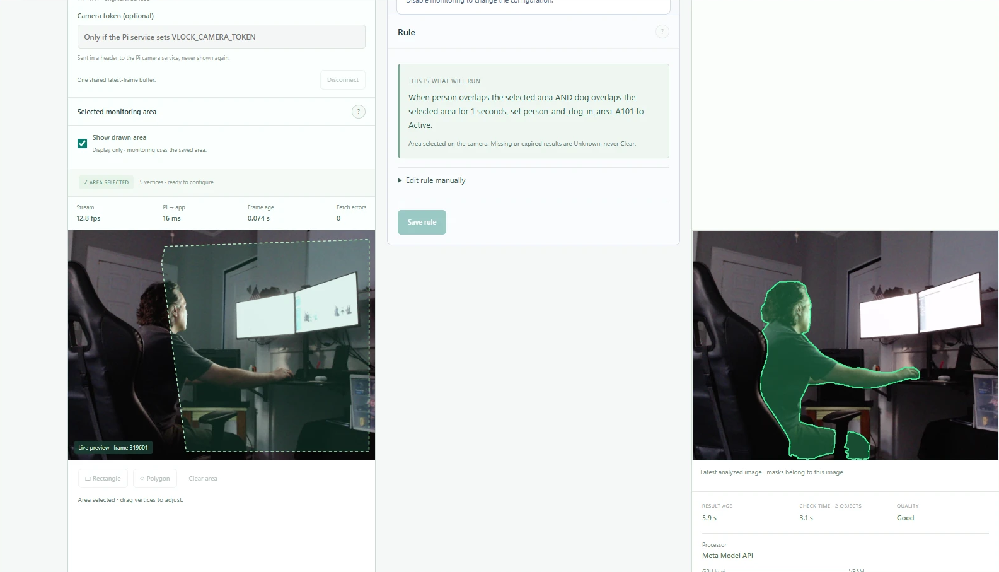
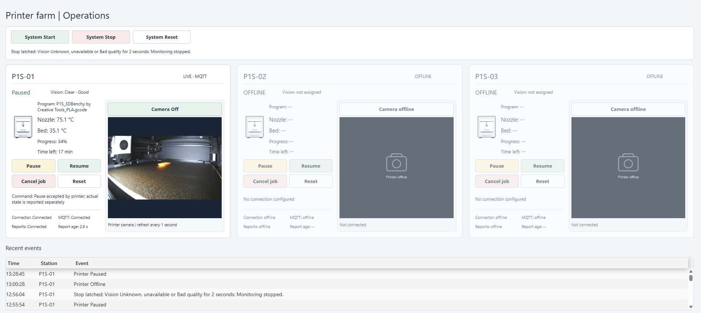
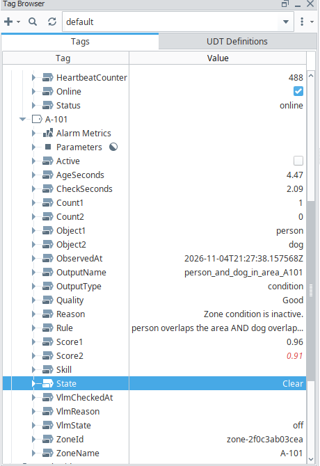
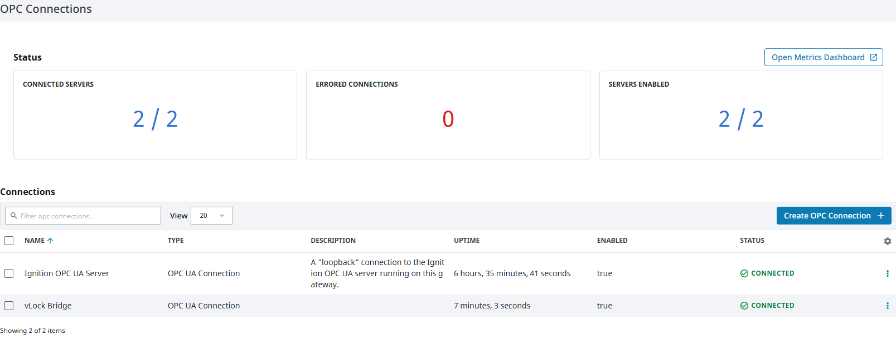

# vLock-AI Vision: Meta Global AI Developer Hackathon 2026

**Submitted:** Indie Developer Track, Push the Frontier, by Ender Celik.

**AI vision that supports industrial safety devices, and an easy way for SCADA developers to add SAM 3.1 to the systems they already run.**

**Demo video:** https://youtu.be/5BJcpr42i7c

**Repository:** https://github.com/celikender/vLock-AI-Vision

## The problem

Machines rely on protective devices such as light curtains, interlocks and presence sensors, but these don't always give the full picture. A person may remain inside a restricted area after passing through a light curtain, or a sensor may not capture everything around a machine. Plants already have cameras and SCADA systems, yet connecting them usually means a custom vision pipeline for every machine.

## The solution

vLock-AI Vision adds visual monitoring alongside existing safeguards, built for SCADA developers. They describe what to monitor in plain English. Muse Spark helps configure it, a person approves the setup, and SAM 3.1 finds the objects. Fixed rules publish `Active`, `Clear` or `Unknown` over OPC UA, MQTT or REST.

**vLock tells SCADA what it sees. SCADA decides what the machine does.**

## The demo

A Raspberry Pi 5 with a USB camera, a Bambu Lab 3D printer and Ignition Perspective. A rule watches for a person's hand approaching a water bottle in the monitored area. When that happens, vLock reports it to SCADA, and SCADA pauses the printer.

## How it uses Meta's models

| Model | What it does here | How it pushes the frontier |
|---|---|---|
| **Muse Spark** | Turns plain language into a proposed rule, using site notes that include measured results from this camera. It can also run optional advisory frame checks | A SCADA developer can configure vision by describing the job |
| **SAM 3.1** | Finds, outlines and tracks the objects named in the rule | Any object you can name, with no training step, feeding a real industrial control system |

SAM 3.1 runs three ways, chosen on the Setup page: a local GPU, the Meta Model API with images, or the Meta Model API with video. All three feed the same rule code.

## Proven end to end

Tested on November 4, 2026 with a Raspberry Pi camera, real Inductive Automation Ignition and a real Bambu Lab P1S 3D printer. These were observed by hand, so no times were measured.

| Scene | Rule: person AND dog | SCADA |
|---|---|---|
| Person alone | `Clear` | No stop |
| Person holding a real dog | `Active` | Stop latched, printer stopped |
| Camera disabled | `Unknown` | Treated as a stop, printer stopped |

This worked on both the local GPU and Meta's cloud. The app only published status: the stop itself came from the demo's SCADA side, as it would in a real plant.

## Measured

| SAM engine | Time per check in the running app | Cost while monitoring, per object |
|---|---|---|
| Local GPU (RTX 3070 Ti Laptop), 4 frames | 4-5 s | No per-use charge |
| Meta image, 1 frame | 2-3 s | Up to about $9 an hour |
| Meta video, 4 frames | 8-17 s, too slow for this use today | About $14 an hour or less |

From one camera and one room. Full details: [test results](../testing/TEST_RESULTS.md) and [edge cases](../testing/EDGE_CASES.md).

## Screenshots

## Limits

This is a working prototype for supervisory monitoring. It is not a fast safety stop, and it **does not replace physical lockout/tagout or safety-rated controls**. It handles one camera and one monitoring job at a time. Accuracy has only been sampled, not benchmarked. Muse's proposals need review and more detailed testing: in one test it got the rule right but left the output type on `event`, and `condition` was chosen by hand. Switching the SAM engine needs an app restart.

## Built during the event

The application, its SAM and Muse integration, the SCADA outputs and the tag contract were built during the event, and the [commits](https://github.com/celikender/vLock-AI-Vision/commits/main) and [development log](../development/DEVELOPMENT_LOG.md) show how. [vLock Digital LOTO](https://github.com/celikender/vLock-Digital-LOTO) is Ender Celik's pre-existing Ignition Perspective demonstration. It is background work, and no implementation was copied from it.

## What's next

Edge devices such as a Jetson and a different architecture to try, faster Meta video, more than one camera, the worker-lock lifecycle, an accuracy benchmark on plant footage, long-duration runs, and a one-step installer.
